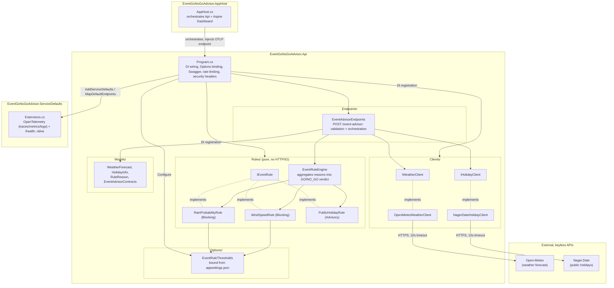

# Architecture Diagram

Component view of `src/`, showing how the API project, its external clients,
the pure rule engine, the shared `ServiceDefaults`, and the Aspire `AppHost`
relate to each other and to the two upstream APIs.

See also: [sequence diagram of `POST /event-advisor`](sequence-event-advisor.md),
[README](../../README.md), [ADR-004: telemetry via Aspire ServiceDefaults](../decisions/004-telemetry-via-aspire-service-defaults.md).
