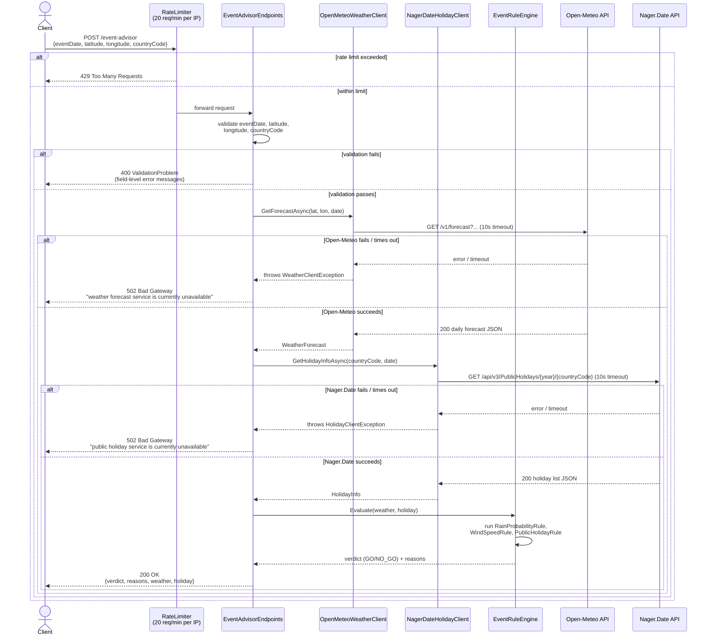

# Sequence Diagram: `POST /event-advisor`

Request flow through validation, the two upstream clients, and the rule
engine, including the `400`/`502` error paths from
[ADR-003](../decisions/003-harden-against-resource-abuse-and-info-leaks.md).

See also: [architecture diagram](architecture.md), [README](../../README.md).
